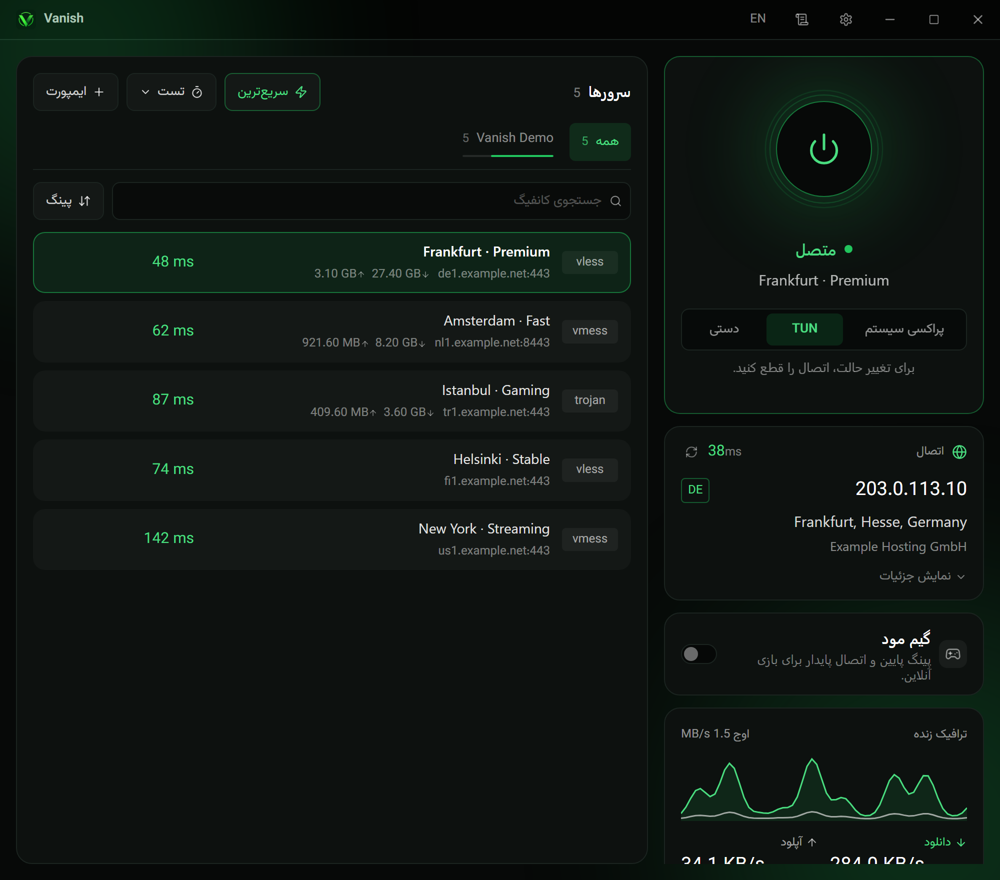
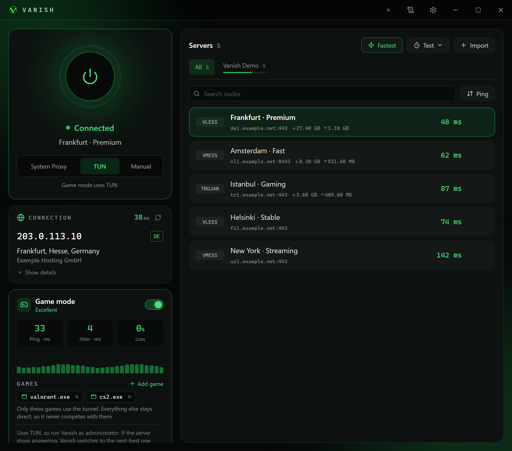
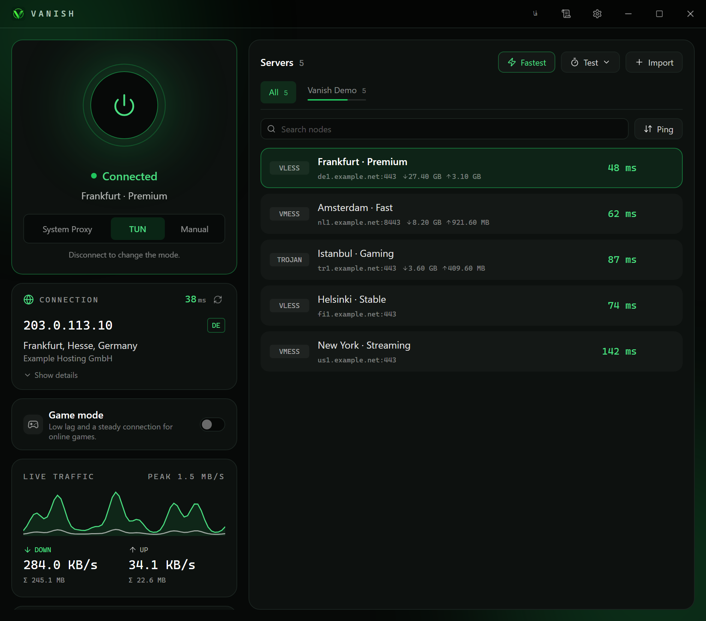
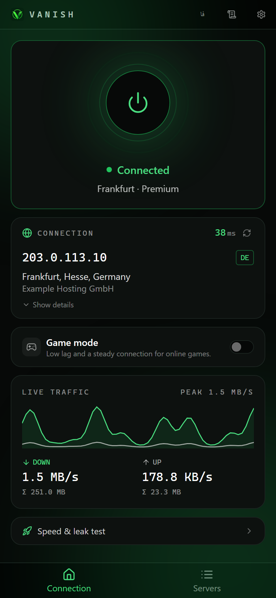
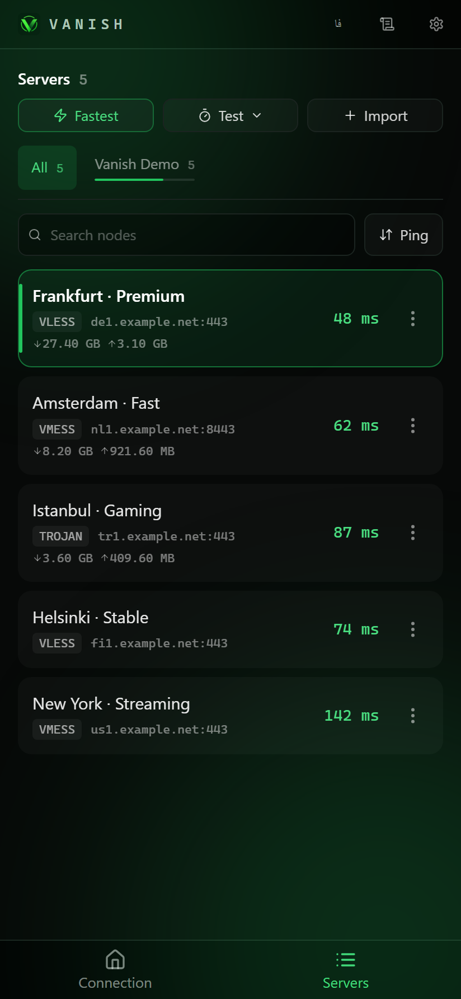
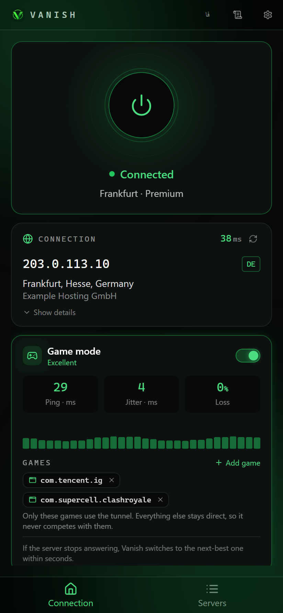

<div align="center">


# Vanish

**کلاینت سریع و مدرن V2Ray / sing-box برای ویندوز و اندروید**<br />
اتصال با یک لمس، اشتراک‌ها با نوار مصرف، «گیم مود» برای بازی با لگ کم، و رابط تیره و تمیز به دو زبان فارسی و انگلیسی.

[](https://github.com/Sobhanafkhami/vanish/actions/workflows/release.yml)
[](https://github.com/Sobhanafkhami/vanish/releases/latest)

[English](README.md) · **فارسی**

</div>

<p align="center">
  
</p>

<div dir="rtl">

> سرورها و آدرس‌های IP داخل عکس‌ها نمونه و ساختگی هستند.

## امکانات

- **پروتکل‌های متنوع** — `vless://`، `vmess://`، `trojan://`، `ss://`، `wireguard://` و JSON خام خروجی sing-box (راه ایمپورت کانفیگ‌های زنجیره‌ای مثل ShadowTLS).
- **اشتراک (Subscription)** — لیست ساده یا base64، به‌روزرسانی خودکار در پس‌زمینه، تب جدا برای هر اشتراک و نوار مصرف (حجم مصرف‌شده/باقی‌مانده و روزهای مانده) که از هدرهای پنل خوانده می‌شود.
- **سه روش اتصال (ویندوز)** — پراکسی سیستم، TUN (کل رایانه) یا دستی (فقط یک پورت محلی).
- **مسیریابی** — سراسری، قانونی (دامنه‌های `.ir` و فهرست‌های خودتان مستقیم می‌روند) یا مستقیم، با DNS روی HTTPS به انتخاب شما.
- **گیم مود** — TUN همراه با فهرستی از بازی‌ها که فقط آن‌ها از تونل می‌گذرند و بقیه‌ی ترافیک مستقیم می‌ماند؛ به‌علاوه keep-alive، NAT از نوع full-cone، نمایشگر زنده‌ی پینگ / جیتر / افت بسته و جایگزینی سریع سرور. [جزئیات](#گیم-مود)
- **ابزارها** — پینگ TCP، *تأخیر واقعی* (یک درخواست HTTP واقعی از هر سرور؛ در اندروید حتی بدون اتصال VPN)، انتخاب سریع‌ترین، تست سرعت و تست نشت (IP / DNS / IPv6).
- **پایداری** — جایگزینی خودکار با سرور بعدی وقتی سرور فعلی جواب ندهد، و کیل‌سوییچ اختیاری.
- **اشتراک‌گذاری و ایمپورت** — QR برای سرورها و اشتراک‌ها، و ایمپورت با یک لمس از کلیپ‌بورد.
- **رابط فارسی (راست‌به‌چپ)** — چیدمان واقعی راست‌به‌چپ با فونت فارسی، نه یک آینه‌ی ساده.
- **به‌روزرسانی خودکار** — در ویندوز با بسته‌های امضاشده؛ در اندروید برنامه GitHub را بررسی می‌کند و وقتی APK جدید بیاید یک snackbar نشان می‌دهد.

<table>
  <tr>
    <td align="center"><br /><sub>گیم مود با نمایشگر زنده‌ی لگ</sub></td>
    <td align="center"><br /><sub>رابط انگلیسی</sub></td>
  </tr>
</table>

## اندروید

نسخه‌ی اندروید همان موتور را دارد (sing-box به‌صورت کتابخانه‌ی درون‌پروسه‌ای پشت `VpnService` اندروید) و چیدمان تک‌ستونه‌ی مناسب انگشت: تب‌های پایین، منوی پایین‌آمدنی برای کارهای هر سرور و نمایش کامل اسم سرورها.

<table>
  <tr>
    <td align="center"><br /><sub>اتصال</sub></td>
    <td align="center"><br /><sub>سرورها</sub></td>
    <td align="center"><br /><sub>گیم مود (به‌ازای هر برنامه)</sub></td>
  </tr>
</table>

## دانلود

| پلتفرم | دریافت |
|---|---|
| ویندوز | [آخرین نصب‌کننده](https://github.com/Sobhanafkhami/vanish/releases/latest) (`Vanish_<version>_x64-setup.exe` یا `.msi`). با هر push به `main` توسط GitHub Actions ساخته و منتشر می‌شود. |
| اندروید ۷ به بالا (arm64) | فایل `Vanish_<version>_android-arm64.apk` در [آخرین release](https://github.com/Sobhanafkhami/vanish/releases/latest). بار اول باید «نصب برنامه‌های ناشناس» را برای مرورگر یا فایل‌منیجر روشن کنید. |

حالت TUN در ویندوز به دسترسی ادمین نیاز دارد. در اندروید، اولین اتصال پنجره‌ی مجوز VPN سیستم را نشان می‌دهد.

## شروع سریع

1. به **Servers ← Import** بروید، یک لینک اشتراک (یا چند لینک `vless://`) را کپی کنید و **Import from clipboard** را بزنید؛ یا آدرس اشتراک را دستی وارد کنید.
2. یک سرور انتخاب کنید (یا **Fastest** را بزنید) و دکمه‌ی بزرگ پاور را بزنید.
3. اختیاری: **گیم مود** را روشن کنید، بازی‌هایتان را اضافه کنید تا فقط همان‌ها از تونل بگذرند.

## گیم مود

گیم مود روی کاری ساخته شده که یک کلاینت واقعاً می‌تواند برای کم کردن لگ انجام دهد:

- فقط بازی‌هایی که در فهرست می‌گذارید از تونل می‌روند و بقیه‌ی ترافیک مسیر کوتاه‌تر خودش را دارد (در ویندوز با قانون به‌ازای پروسه و در اندروید با VPN به‌ازای برنامه)؛
- TUN با NAT از نوع full-cone تا UDP و ترافیک peer-to-peer درست کار کند؛
- keep-alive کوتاه TCP و یک پروب هر دو ثانیه که هم تونل را زنده نگه می‌دارد و هم نمایشگر **پینگ / جیتر / افت بسته** را تغذیه می‌کند؛
- اگر سرور جواب ندهد، Vanish به‌جای نیم دقیقه ظرف چند ثانیه به سرور بعدی می‌رود.

این **یک «بهینه‌ساز مسیر چندگانه»** مثل VPNهای تجاری بازی **نیست**: آن‌ها شبکه‌ی سرور اختصاصی خودشان را دارند و بسته‌ها را روی چند مسیر کپی می‌کنند، که از یک کلاینت برای سرورهای خودتان برنمی‌آید.

## ساخت از روی سورس

پیش‌نیازها: Node 20+، Rust و [پیش‌نیازهای Tauri](https://v2.tauri.app/start/prerequisites/) (در ویندوز: MSVC Build Tools).

</div>

```bash
npm install
npm run fetch-core        # sing-box رسمی را در src-tauri/binaries می‌گیرد (داخل برنامه بسته‌بندی می‌شود)
npm run tauri dev         # یک نمونه‌ی جدا (dev) می‌تواند کنار Vanish نصب‌شده اجرا شود
```

```bash
npm run build:app         # نصب‌کننده‌های NSIS و MSI در src-tauri/target/release/bundle/
```

<div dir="rtl">

ترتیب جست‌وجوی هسته: تنظیم `core_path`، پوشه‌ی `bin/` در داده‌های برنامه، منابع بسته‌بندی‌شده، کنار فایل اجرایی و در نهایت `PATH`. اگر پورت‌های تنظیم‌شده اشغال باشند (مثلاً توسط Nekoray)، Vanish پورت آزاد انتخاب می‌کند. داده‌ها در `%APPDATA%\app.vanish.client` (فایل‌های `nodes.json` و `settings.json`) هستند. از برنامه‌ی نصب‌شده هم‌زمان فقط یک نمونه اجرا می‌شود.

**اندروید:** برای ابزارهای لازم، ساخت `libbox.aar` با `scripts/build-libbox.sh` و تنظیم امضا به [docs/android.md](docs/android.md) نگاه کنید.

## انتشار نسخه

فایل `.github/workflows/release.yml` با هر push به `main` اجرا می‌شود:

1. job به نام **`release`** نصب‌کننده‌های امضاشده‌ی NSIS و MSI را روی ویندوز می‌سازد، نسخه را به‌صورت `<major>.<minor>.<شماره‌ی اجرا>` (از `package.json`) می‌زند و release با نام `v<version>` را همراه `latest.json` برای آپدیت درون‌برنامه‌ای می‌سازد.
2. job به نام **`android`** برنامه‌ی `libbox` (با کش) و یک APK امضاشده می‌سازد و `Vanish_<version>_android-arm64.apk` را به همان release پیوست می‌کند.

Secretهای مخزن:

| Secret | کاربرد |
|---|---|
| `TAURI_SIGNING_PRIVATE_KEY` (و `_PASSWORD` اگر رمز دارد) | امضای بسته‌های به‌روزرسانی ویندوز |
| `ANDROID_KEYSTORE_BASE64`، `ANDROID_KEYSTORE_PASSWORD`، `ANDROID_KEY_ALIAS`، `ANDROID_KEY_PASSWORD` | امضای APK اندروید |

از هر دو کلید نسخه‌ی پشتیبان بگیرید و هرگز در مخزن نگذارید: بدون کلید ویندوز نصب‌های موجود دیگر آپدیت نمی‌شوند، و آپدیت اندروید فقط روی برنامه‌ای نصب می‌شود که با همان keystore امضا شده باشد. برای شروع یک خط minor جدید، `version` را در `package.json` عوض کنید (مثلاً `0.2.0`).

## چطور کار می‌کند

</div>

```
Vue 3 + Tailwind UI ──invoke / events──▶ Rust (Tauri v2)
                                          ├─ nodes, subscriptions, usage, settings
                                          ├─ ساخت کانفیگ sing-box (routing, DNS, TUN, game mode)
                                          └─ نظارت بر هسته
Windows:  sing-box child process  +  system proxy / TUN
Android:  libbox (in-process)     +  VpnService (Kotlin plugin)
```

<div dir="rtl">

رابط کاربری فقط از طریق Clash API روی `127.0.0.1` با هسته صحبت می‌کند؛ برای همین نمودار ترافیک، تست تأخیر و کارت IP خروجی روی هر دو پلتفرم یکسان کار می‌کنند.

## وضعیت پروژه

Vanish پروژه‌ای جوان است. ویندوز هدف اصلی است؛ برنامه‌ی اندروید روی یک گوشی واقعی (اندروید ۱۲) تست شده و فقط برای arm64 ساخته می‌شود. هنوز انجام نشده: موتور xray-core (سوییچ آن هست ولی خطا می‌دهد) و پراکسی سیستم در macOS. گزارش مشکل و pull request خوش‌آمد است.

## تشکر

بر پایه‌ی [sing-box](https://github.com/SagerNet/sing-box)، [Tauri](https://tauri.app)، [Vue](https://vuejs.org) و آیکون‌های [Lucide](https://lucide.dev). فونت فارسی رابط [وزیرمتن](https://github.com/rastikerdar/vazirmatn) است.

</div>
